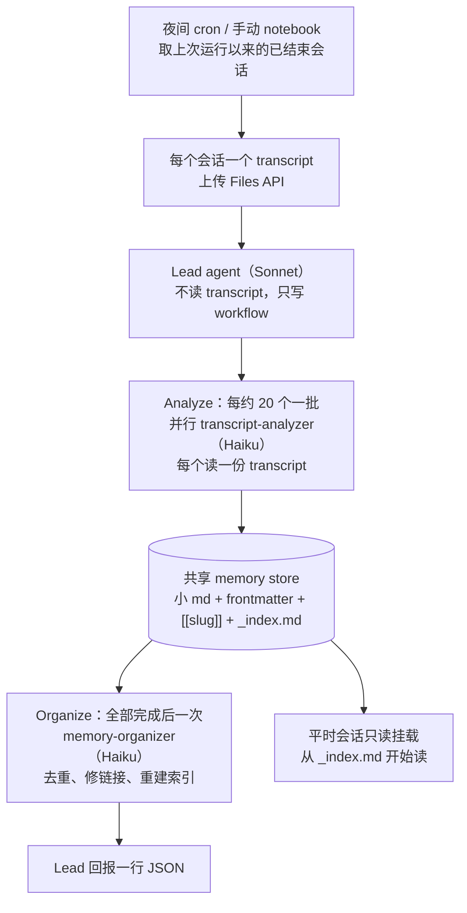
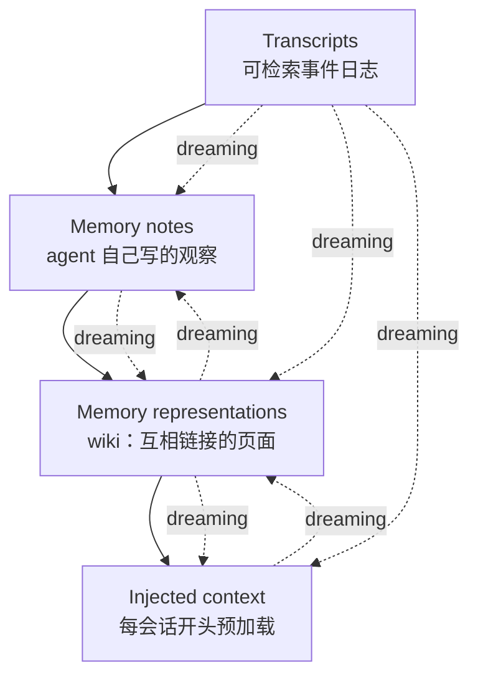

# Dreaming cookbook 与《The components of agent memory》：实现 vs 框架

2026-11-08 讨论底稿。比较两份官方材料的关系，不是设计定稿。

## 一句话

cookbook 是可运行的实现，文章是概念框架和实测。cookbook 只覆盖文章四层里的 **memory notes / index 层**；文章还讲了 wiki 表示层、注入层和评测。两者不是同一层东西，但底层假设相同：外部文件、离线回看 transcript、不改模型权重。

## 一、cookbook 的架构

关键点：lead 不碰记忆文件；analyzer 各读一份 transcript，并行写共享 store；organizer 最后统一去重、修 frontmatter 和链接、重建 `_index.md`；合并掉的文件留 `MOVED TO [[slug]]` 占位，notebook 再删占位。工具只有 read / write / edit / glob / grep，没有 shell 和网络。成本：11 份 transcript、283KB，约 $0.36、2.5 分钟。

## 二、文章的架构

关键点：文章不规定 lead / analyzer / organizer 这条流水线；它定义的是四类组件和 dreaming 的五种作用——修正 note、建 wiki、把 note 提升到注入层、让记忆围绕目标生长、跨会话补缺口。它明确把权重变化、单次会话的 in-context learning、compaction 排除在 agent memory 之外。

## 三、对照

| 维度 | Dreaming cookbook | Components 文章 |
|---|---|---|
| 类型 | 可运行 notebook + 四个 prompt | 概念框架 + 实测文章 |
| 核心问题 | 怎么搭一条 dreaming 流水线 | 记忆由哪些层组成、dreaming 在每层做什么、效果如何 |
| 流程 | lead → N 个 analyzer → organizer | 不规定流水线；描述五种 dreaming 作用 |
| 记忆形态 | 小 md + frontmatter + `[[slug]]` + `_index.md`，属于 notes/index 层 | 四层：transcript / notes / wiki / injected context |
| 触发 | 夜间 cron；手动默认取 14 天 | 不规定；讨论何时写、何时刷新 |
| 审阅 | 默认不审，靠 git 回滚（我们的适配） | 不设审阅门；讲 dreaming 如何用 transcript 校正记忆 |
| 评测 | 按精读笔记，是固定事实清单，主要量召回 | CL-Bench、Pokémon、Stainless wiki、合同任务 |
| 产物 | 可跑的代码、四个 prompt、成本数据 | 设计约束、实测数字、开放问题 |

## 四、相同与不同

**相同**

- 记忆都是外部文件，不改模型权重。
- dreaming 都在离线回看 transcript。
- 都用小文件 + 链接 + 索引，而不是一个大文件。
- 都把 transcript 当事实来源，把工具输出/文档当不可信数据。
- 都默认没有人工审阅环节。

**不同**

- cookbook 是一个具体实现，文章是设计空间。cookbook 只实现了 notes 层；文章明确还有 wiki 表示层和注入层。
- 文章给出了 cookbook 没有的结论：注入层必须小（Claude Code 只加载 `MEMORY.md` 前 200 行/25KB）；wiki 要配 search，单独 wiki 在跨文档综合题上才有优势；wiki 会膨胀、要花 compute 维护；给一般性指导比给“只记失败”这类固定规则更有效。
- cookbook 的评测只量召回；文章给了多套评测和设计约束。
- 文章的 dreaming 是五种作用；cookbook 的 dreaming 只有“analyze → organize”两步。

## 五、对 v3 的意义

- cookbook 是基线（PO 11-07 定），给的是可运行骨架。
- 文章说明：cookbook 的 store 只是 notes 层；要补全，得加 wiki 表示层（knowledge-wiki quickstart 已收）和小的注入层（对应我们的 `MEMORY.md` 索引）。
- 文章的“注入层要小、细节下沉、链接留在上层”正好对应我们 `MEMORY.md` 的 200 行/25KB。
- 文章的“dreaming 用 transcript 校正 note”支持我们在 organizer 前加验证；“dreaming 建 wiki”支持第二层；“dreaming 提升 note”支持索引维护。
- 文章也警告 wiki 膨胀和维护成本，这会影响我们要不要做 wiki、做到多大。

## 参考

- `reference/agent-memory/dreaming-cookbook/`：cookbook 原件、四个 prompt、11 份示例 transcript
- `reference/agent-memory/components-of-agent-memory/`：文章快照、离线可读版、事实摘录
- `docs/cookbook-port-notes.md`：cookbook 精读笔记与移植清单
- `docs/dreaming-architectures.md`：cookbook、auto-dream、v3 三种做法对照
