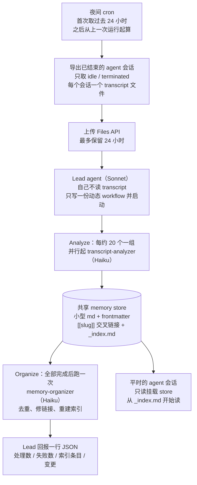
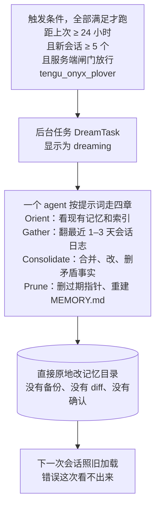

# 做梦的三种架构

看不懂长文档时先看这里。两张架构图分别对应 Anthropic 官方 cookbook《Dreaming with a dynamic workflow》和 Claude Code 内置的 auto-dream（提取自 `reference/agent-memory/auto-dream/auto-dream.md`），最后一张表把两者和我们的 v3 方向摆在一起。

## 一、cookbook：把 dream 做成一条流水线

读这张图只要记住三件事：

| 谁 | 干什么 | 不干什么 |
|---|---|---|
| Lead（Sonnet） | 写 workflow、分组、汇总 | 不读 transcript、不碰记忆文件 |
| Analyzer（Haiku，N 个并行） | 每个读一份 transcript，提炼、修正、补进 store | 不互相覆盖，只追加和链接 |
| Organizer（Haiku，跑一次） | 去重、修 frontmatter 和链接、维护 `_index.md` | 不丢事实 |

安全边界：三个 agent 都是预定义的，工具白名单只有文件读写五个（无 shell、无网络）；transcript 当不可信输入；无人值守时任何要审批的调用直接拒绝。

## 二、官方 auto-dream：把 dream 写成一段提示词

和 cookbook 比，它的特点是「一个 agent、一段提示词、原地改」：聪明全在提示词里，代码只负责门控、加锁、拉起任务。官方目前把服务端闸门关着：用户可以设 `autoDreamEnabled: false` 永久关闭，但设 `true` 开不起来。

## 三、三种做法对照

| | 官方 auto-dream | cookbook 做梦服务 | 我们的 v3 方向 |
|---|---|---|---|
| 跑在哪 | Claude Code 进程内，后台任务 | 独立服务，夜间 cron | Claude Code 会话 |
| 谁干活 | 一个 agent，一段提示词 | lead + N 个 analyzer + organizer | 待定，倾向 lead 分派 |
| 写哪 | 原地改现有记忆 | 原地改 memory store（保留 memory version，跑前留副本） | 提案 + wiki |
| 谁来审 | 没人 | 默认没人（可改成先写新 store 再切换） | **PO 审 diff 后才采纳** |
| 已知事故 | #47959：一天删掉 23 个记忆文件，用户无感知 | 未大规模运行 | — |
| 现在的状态 | 闸门关着，不放行 | 官方 cookbook，可自建 | 设计中 |

一句话：官方 auto-dream 栽在「无人审的原地写」，cookbook 把它拆成流水线、加了审计和边界但仍然默认无人审，我们 v3 的规矩（只出提案、审 diff、不可重建的负结果不能动）是同一件事上最保守的一档。

详细原料：cookbook 原件在 `reference/agent-memory/dreaming-cookbook/`，auto-dream 提取在 `reference/agent-memory/auto-dream/auto-dream.md`。
