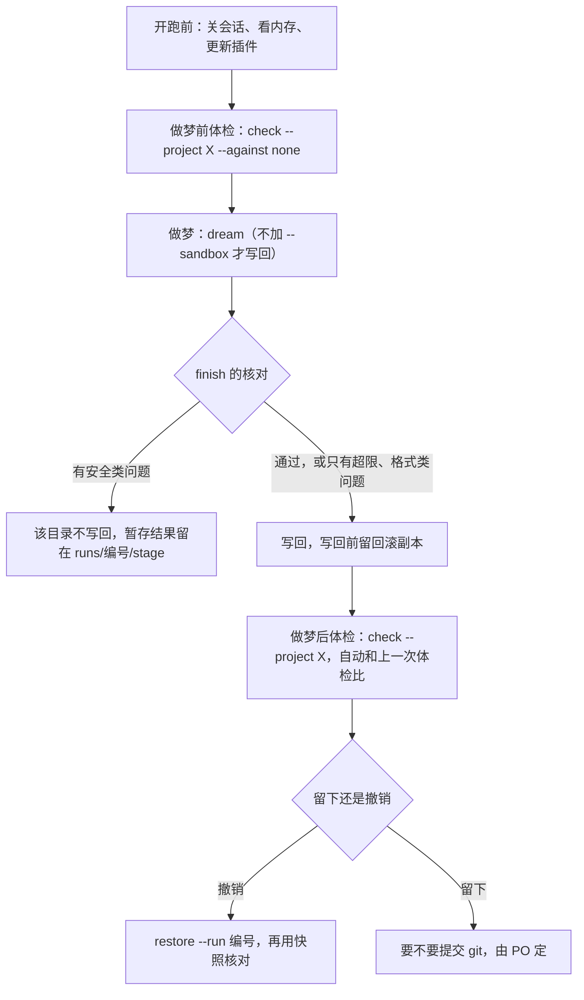

# 运行说明：做梦和体检

插件 `dreaming` 0.2.3 的运行注意事项，写给运行它的人（PO、Developer）。内容来自 Sprint 01 在 CLI 和桌面端的实测（2026-11-09）；Claude Code 的版本变了，先复核再照做。命令的参数见各技能的 `argument-hint`，这里只写怎么跑、会发生什么、出问题怎么办。

## 1. 一次真实写回的顺序



| 命令 | 作用 |
| --- | --- |
| `/dreaming:dream` | 读会话记录，分段交给 analyzer，再由 organizer 整理；agent 只改暂存副本，核对通过才整个目录写回。加 `--sandbox` 只跑不写回 |
| `/dreaming:check` | 体检：每条记忆一个结论加证据，不改文件。`--against none` 不和之前的体检比；`--memory-from <运行编号>[:base\|:stage]` 查某次运行里的副本，不查现在的记忆 |
| `/dreaming:restore` | 撤销一次写回。不带参数撤销最近一次；`--run <运行编号>` 指定哪一次，写回后又被别处改过的文件先列出来，不覆盖，要覆盖加 `--force` |
| `/dreaming:smoke` | 环境冒烟测试 |

四个命令都只许人敲（技能设了 `disable-model-invocation`）。dream、check 和 smoke 先跑脚本，再弹 workflow 的批准卡片（桌面端选 Once），最后再跑脚本、打出一段英文结果；restore 一步出结果。会话要一直开着，直到这段结果出来。

## 2. 开跑前

| 要查的 | 做法 | 原因 |
| --- | --- | --- |
| 可用内存 | 任务管理器“性能 → 内存”里的“可用”至少 5 GB；不够就关 VS Code、浏览器和用不到的会话 | 16 GB 的机器上，后台任务在可用内存约 2.2–2.9 GB 时被系统停过两次；开跑到最低点会掉约 1 GB；agent 本身占得不多，占内存的是常驻程序 |
| 写同一个记忆目录的会话 | 关掉起始目录对应这个记忆目录的会话 | 做梦期间有别处写这个目录，写回时发现文件被改过，这个目录整个不写回 |
| 记忆目录在 git 里是否干净 | `git -C <记忆仓库> status --short -- <目录>` 没有输出 | 写回后看 diff 时，不会混进别的改动 |
| 插件版本（桌面端） | 桌面端读缓存里的插件：`claude plugin marketplace update claude-dream`，再 `claude plugin update dreaming@claude-dream --scope local`，`claude plugin list` 看版本；更新后新开会话，已开着的会话还是旧代码 | 改了插件代码要先升 `plugin.json` 的版本号，版本号不变 `claude plugin update` 认为已是最新，不会重新复制到缓存 |
| `claude -p`（CLI） | 加环境变量 `CLAUDE_CODE_PRINT_BG_WAIT_CEILING_MS=0`，再加 `--plugin-dir <插件目录> --permission-mode default --allowedTools Workflow` | lead 最后一轮结束 10 分钟后，后台 workflow 会被停掉 |
| 发起目录 | 测试时在 `C:\Users\seapawn\AppData\Local\Temp\claude\dream-probe` 里开会话 | 插件只装在这个目录（local scope）；它登记为测试目录，在里面开的会话不会被当成做梦的原料。读哪些会话、写哪个记忆目录，按每个会话自己的目录定，和发起目录无关 |
| 开跑前的快照 | 想独立核对写回和恢复，先把记忆目录复制一份放在仓库外（它是私人记忆） | 见第 5 节 `tools/verify_real_run.py` |

## 3. 耗时和用量（参考）

| 运行 | 规模 | 耗时 | 用量 |
| --- | --- | --- | --- |
| 做梦，桌面端（DeepSeek） | 8 段 | 11–16 分钟 | 读缓存约 1000–1200 万 token，输出约 20 万 |
| 做梦，CLI（Haiku） | 193 段 | 79 分钟，中途被系统停过一次，用 `--continue` 续跑 | 读缓存约 1.9 亿 token |
| 做梦，整个会话记录目录 | 310 段（跳过测试目录后） | 估约 2 小时 10 分 | — |
| 体检 | 13–25 条，2–4 个 checker | 4–9 分钟 | — |

## 4. 中途断了怎么办

| 情况 | 做法 |
| --- | --- |
| 额度用完 | workflow 自己暂停，额度恢复后接着跑；会话别关，什么都不用敲 |
| 会话或桌面端被关掉、电脑重启、后台任务被系统停掉 | 先确认原来那次已经停了；脚本也会挡一下，原运行 5 分钟内还有写入就拒绝续跑。然后新开会话，敲 `/dreaming:dream --continue <运行编号>`。运行编号是开头打出的 `run: dream-…`，也可以在 `~/.claude-dream/runs/` 里按时间找最新的。已做完的段不重做，只跑剩下的；有段重跑的目录会再整理一次；最后照常核对、写回 |
| 电脑睡眠 | 醒来后看会话里还在不在跑；不在跑就照上一行续跑 |
| 体检断了 | 重新敲同一条命令 |

## 5. 跑完以后

**看结果。** 报告在 `~/.claude-dream/runs/<运行编号>/`：体检看 `check-report.md`，做梦看 `run-report.json`；`base/` 是开始时的副本，`stage/` 是 agent 改的副本，`backup/` 是写回前的回滚副本，`hooklog.jsonl` 是守卫的日志。渲染出来的会话记录每条命令跑完就自动删了。写回了什么：`git status --short -- <目录>`，`??` 是新增的文件，`M` 是改过的；改过的文件用 `git diff` 看，新增的文件 `git diff` 看不到，直接打开或看 `run-report.json` 里的清单。写回不提交 git，什么时候提交、推送由 PO 定。

**问题分两类**（finish 的输出）：

| 类 | 开头 | 后果 | 包括 |
| --- | --- | --- | --- |
| 安全类 | `PROBLEM (this directory is not written back)`，开头一行 `SOME CHECKS FAILED` | 这个目录一个文件都不写，暂存结果留在 `runs/<编号>/stage/` | 有段没分析出结果；开始时就有的记忆文件找不到了或被删；hook 核对不过（agent 用了 shell 或网络、写到工作目录外、日志有读不了的行）；写回时发现文件被别处改过 |
| 超限和格式类 | `REPORTED, written back anyway` | 不拦，目录照样写回 | `MEMORY.md` 超过 200 行或 25 KB（超出的部分新会话看不到）；单个文件超过 100 KB；这一轮新增或改过的文件格式不对；整理环节没出结果 |

lead 在等 workflow 时偶尔多跑一条命令（桌面端的 DeepSeek 做过，例如 `ls`），守卫会拦下，finish 单独列出（`lead shell commands blocked by the guard`），不算失败。

**撤销。** 照 dream 输出最后一行 `to undo:` 之后的那条敲（`/dreaming:restore --run dream-…`），输出里应有 `identical to before the run=True`。回滚副本在 `runs/<编号>/backup/`，验收以后再删。要独立核对：

```
python -I tools/verify_real_run.py <运行编号> --snapshot <开跑前的快照目录>
```

写回后应有“真实目录 == 暂存结果”，撤销后应有“真实目录 == 快照”。`tools/run_numbers.py` 算一次运行的模型、耗时、token、写入调用数，`tools/replay_lead_commands.py` 在改 lead 命令的规则之前，拿所有真实日志里的命令过一遍新规则。

## 6. 及格线（体检前后对比）

`check.py compare`（`/dreaming:check` 自动调用）每次算三个数：

- **下降比例**：做梦改过的老条目里，“可能过时＋错误”少了几条，除以改过的条数；
- **波动比例**：没改过的老条目里，结论在“可能过时、错误”和其他之间翻转的条数，除以没改过的条数，这是体检自己的噪声；
- **差** = 下降比例 − 波动比例。

PO 定的规则：差 > 0 算通过；改过的老条目少于 30 条时不下结论，记“数据不足”（`check.py` 里的 `B_MIN_DIFF`、`B_MIN_CHANGED`）。依据：同一份 25 条记忆连查三次，结论完全相同的 CLI 80%–92%、桌面端 76%，波动比例 0.04–0.12；做梦什么都没改善时，改过 30 条、没改过 30 条，差 > 0 的机会约 4%–8%，14 条和 12 条约 12%–14%。所以老条目只有十几条的目录（比如 IDEO-Scrum 的 13 条），结论必然是“数据不足”。

## 7. 已知的现象

- **桌面端答话的是 DeepSeek V4.1 Flash**（网关映射），技能和子代理里写的 `model:` 不起作用；CLI 是 Claude。噪声和成本按实际在答的模型估。
- **`--session` 会多渲染一段**：只选部分会话时，被选中的 fork 的父会话不在去重范围里，它们共有的消息归 fork，批次比预期多几段；内容没错。
- **organizer 没有删除工具**：本轮新建的文件被合并时，会留下 38 字节的 `MOVED TO` 存根，没有索引条目，PO 可以自己删。
- **做梦写进记忆的内容偏杂**：原始调研记录、历史快照型的条目会被写进去，体检里新增条目 46%–91% 被判过时或错误（CLI 46%，桌面端 64% 和 91%）；改进在 PBI-013。
- **旧运行的副本不会自动清理**：`~/.claude-dream/runs/` 会越积越多，要手动删，PBI-015。
- **敏感内容过滤没做**（PBI-008）：会话里的密钥和私人内容可能被读进记忆。写回后、推送前先看一眼 diff。
