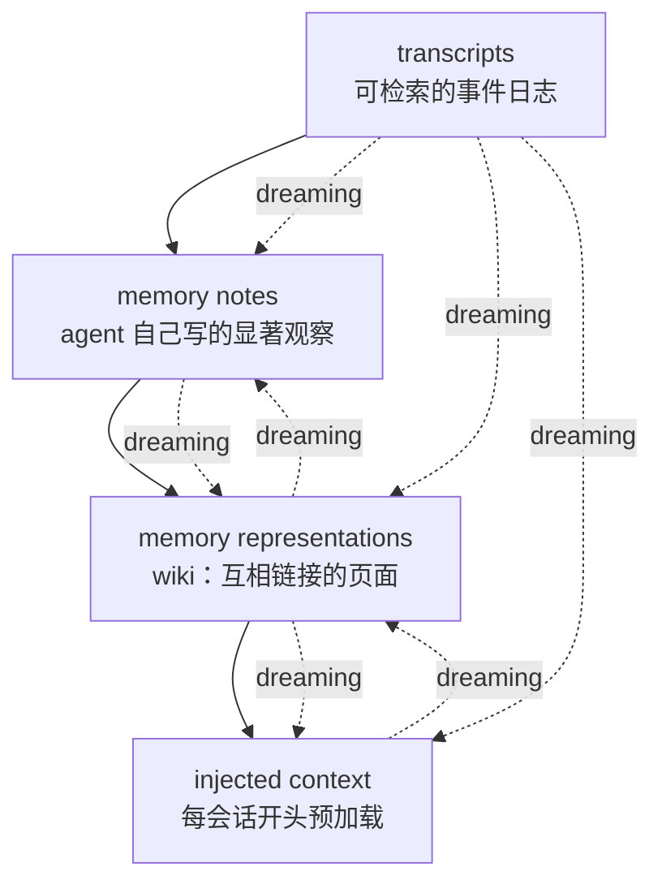

# The components of agent memory（Anthropic，2026-11-06）

- 原文：https://www.anthropic.com/research/components-of-agent-memory
- 发布：2026-11-06（页面 `article:published_time`；最后修改 2026-11-06 21:15 UTC）
- 作者：Lance Martin；编辑 Caitlin Love、Tom Chivers、Rebecca Hiscott、Jake Eaton、Blake Wilson；图 Monika Tuchowska
- 抓取：2026-11-07。`article.html` 为原样快照。
- 性质：Anthropic 官方工程文章。本文件是事实摘录与短引文，不是全文翻译；带「图 N」的数字来自文章图表，正文没有逐字重复。引用前对照 `article.html`。

## 文章的定义

Agent memory 指 Claude 从经验（用户交互、被指派的任务）中获得、跨会话保留、以后能读到的知识。文章明确排除三类：权重变化、单次会话内的 in-context learning、compaction（用摘要替换旧回合以便继续工作）。

> “knowledge that Claude gains from experience—including interactions with users and tasks it's been assigned—and that it retains between sessions, saved as context it can read later.”

## 记忆层级

文章按从下到上讨论四类组件，并称之为 memory hierarchy：

| 层 | 文章里的说法 | 作用 |
|---|---|---|
| transcripts | 可检索的事件日志 | 原始经验；dreaming 的 ground truth |
| memory notes | agent 自己写下的显著观察，例如一个 memory-tool 文件夹 | 会话中抓住重点，供以后读 |
| memory representations | 知识地图，例如 wiki：一组互相链接的页面 | 让 agent 在增长的知识库里导航 |
| injected context | 每会话开始时预加载的上下文 | 不用搜索就能拿到的入口 |

## dreaming 做什么

Dreaming 是离线反思：Claude 在空闲时间回看 transcript，修正错误、写笔记、建表示、决定注入什么。文章把它类比为睡眠中海马体对近期经验的 replay，并明确建立在 Letta / UC Berkeley 的 sleep-time compute 之上。

文章给出的五种作用：

1. **修正记忆**：拿 note 对 transcript 校验。Pokémon 的 Mt. Moon 例子：Claude 把 PokéCenter 记错在东侧，dreaming 对照 transcript 改对后，它重新进洞并最终到达 Cerulean City；不改的那次掉了三次，写下“I'm going to stop rather than keep looping.”，最后退回 Pewter City，没到 Cerulean。
2. **建立新的表示**：用 dreaming 增量建 wiki，后续轮次继续增删、合并重复、核对 claim。
3. **把 note 提升到注入层**：dreaming 把细节留在下层、把链接留在上层，保持注入层小。
4. **让记忆围绕特定目标生长**：例如助手类产品把记忆组织在“它服务的人”周围。
5. **补会话留下的缺口**：跨多个会话找共同模式、修常见错误、补上指向不存在页面的链接。

## 实测结果

### CL-Bench 1.0（图 3）

每个问题从新会话开始，唯一例外是可以读一个跨会话保留的记忆目录。

| 模型 | 无记忆 | 有记忆 |
|---|---|---|
| Opus 5.5 | 0.655 | 0.838 |
| Sonnet 5.5 | 0.644 | 0.833 |
| Opus 5 | 0.564 | 0.828 |
| Opus 4.7 | 0.383 | 0.700 |
| Sonnet 5 | 0.306 | 0.610 |
| Sonnet 4.6 | 0.330 | 0.364 |

模型行为差异：Sonnet 4.6 只写未经验证的猜测；Opus 4.7 把笔记合并成一份参考文档并标记已核实/未确认；Sonnet 5 在评分后标记 confirmed，答错时写 correction；Opus 5 第一个闭环——条目里有规则、规则怎么被验证、之前问题的答案、以及踩过的坑的警告。

### Pokémon Red（约 10,000 步）

| 模型 | 记忆规模 | 进度 |
|---|---|---|
| Sonnet 3.7 | 413 个文件、225 个文件夹 | 1 枚徽章 |
| Fable 5 | 2 个文件夹里的 9 个文件 + 顶层 `global.md` | 4 枚徽章 |
| Opus 5.5 | 类似的小文件夹，随玩随改 | 通关 |

Sonnet 3.7 把一切都记下来，但游戏状态一直在变，记录不断过期；到第 10,000 步附近，它在 17 步里建了 6 个文件、删了 9 个，没在游戏里做任何动作。Fable 5 只记屏幕读不到的东西：`global.md` 是仪表盘（当前目标、道馆计划、自己的记忆规则），`locations/` 放路线计划，`gameplay/` 放策略。它写下的一条规则：

> “If 3+ balls fail in a row, VARY the timing (insert extra ‘wait’ presses between menu steps) - the catch landed right after doing this.”

### 怎么给模型下指令（图 5）

- 只告诉 Claude “有一个记忆文件夹可用”，对 Opus 4.7 和 Opus 5 就足够有效。
- 给固定规则反而可能削弱效果：规则设为 “record only failures” 时，Opus 5 的记忆增益减少 0.234，Opus 4.7 减少 0.150，Sonnet 4.6 只减少 0.020。
- 对旧模型，提示帮助最大：让 Sonnet 4.6 先读记忆再回答、并显式测试自己的理论，分数从 0.364 升到 0.641；Sonnet 5 不用提示，10 次里有 9 次会先读记忆。
- 文章对前沿模型的做法：只给简单指导——有人要求时、或明显值得记时写 note，判断留给 Claude。

### Wiki：Stainless 语料（图 10）

约 350,000 个文件、约 420M tokens，25 个问题；dreaming 从 2 个会话扩到 128 个会话。

- 只用 wiki：13% → 48%。
- wiki + search：54% → 61%；只用 search 是 53%。
- 同时用 search 和 wiki，每个问题约省 20,000 tokens。
- wiki 规模：2 个会话后 103 页、766 条链接；128 个会话后 222 页、12,893 条链接（图 10 数据）。

### Wiki 什么时候有用（图 11、图 12）

- 需要跨文档综合、判断或算术的并购问题：wiki 87%，只用 search 73%。
- 单文档就能检索到答案的 LAB 任务：没有明显增益。
- 会膨胀：有一个 wiki 长到语料的 1.77 倍（68 页、203 KB，对比原文 115 KB）。文章拿博尔赫斯《论科学的精确性》里“和帝国一样大的地图”作比。

### 用指令把记忆聚焦到目标（图 14）

并购合同任务里，多个 agent 同时写一张共享的合同条款表，互相覆盖，最后 57 条事实只剩 41 条（72%）。后来用一个“反思失败 → 改指令 → 重建 wiki”的循环，找到的改法是：**每份合同单独一页，由单个 agent 逐字引用条款，不做共享摘要**。改完后评分标准 100% 满足，从 72% 提升上来。

### 第二次 dreaming（图 15）

一次 dreaming 找到 9 条指向不存在页面的链接，改指到同一文档的已有页面，并新增 3 页（含一个索引）；条目从 38 条、225 条链接增长到 41 条、278 条链接。

## 文章给出的做法

- **给一般性指导，不给固定规则**；让模型自己判断什么值得记。固定规则可能削弱强模型的记忆收益。
- **注入层必须小**。注入的记忆占 token，错误 note 会被带进每个会话；更长的指令文件会降低 adherence。文章引用 Claude Code auto memory 的做法：只加载 `MEMORY.md` 前 200 行或 25 KB，这个头部就是索引。
- **wiki 和 search 结合最有效**；wiki 的优势在跨文档综合，不在单文档检索。
- **wiki 需要 compute 维护**，否则会积累错误和幻觉；要控制膨胀。
- **用 transcript 当 ground truth**：dreaming 的价值之一就是把 note 拿回原始记录校验。

## 文章列出的开放问题

- 什么时候写记忆：会话中写，能立刻用，但会分散注意力；留给 dreaming，后台化，但输出不一定马上可用。
- 怎么保持新鲜：全量持续校验不现实；应聚焦可能变化的信息，或按访问频率调整 dreaming 的节奏。
- 表示（wiki）需要持续 compute 维护，否则 drift / 幻觉会累积。
- 没有模型能预知未来需要什么——这正是 dreaming “向后看”的价值。

## 与 cookbook、Claude Code 的关系

- 文章末尾指向两个 cookbook：dreaming 和 knowledge wikis。它是 cookbook 的概念框架和实证依据；cookbook 是可运行的实现。
- 文章提到的产品/系统：Claude Managed Agents（dreams、memory directory）、memory tool、Claude Code auto memory、Claude Duet、Claude Plays Pokémon。
- 文章明确把 Claude Code auto memory 的 200 行 / 25 KB 注入上限当作“注入层要小”的实例。

## 关键引文

> “Memory is, occasionally, a prediction.”

> “If 3+ balls fail in a row, VARY the timing (insert extra ‘wait’ presses between menu steps) - the catch landed right after doing this.”

> “I'm going to stop rather than keep looping.”

> “the top layer of the memory hierarchy has to stay relatively small, and much of dreaming's work here is keeping it that way—by moving some details down the hierarchy and leaving links behind.”

> “Like the mapmakers in Borges's one-paragraph short story ‘On Exactitude in Science,’ who drafted a map so detailed it was as large as the empire it represented, Claude had made an extremely detailed wiki that effectively abstracted nothing.”
