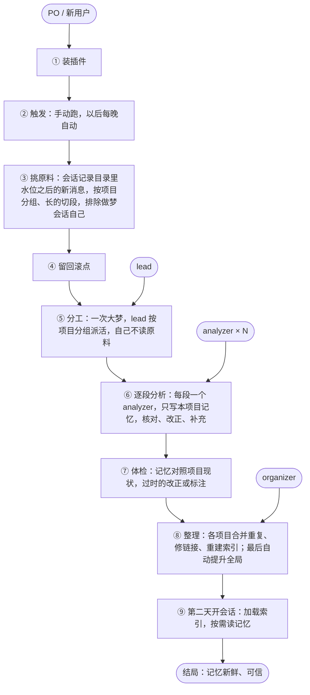

# Product Backlog — ClaudeDream

> Product Owner：SeaPawn | 开始：2026-11-08
> 写法见 scrum-kernel 的 `conventions/product-log.md`。

## 1. 产品

### 1.1 Product

ClaudeDream 是一个 Claude Code 插件，让 Claude Code 做梦：回看过去的会话，整理记忆。

边界（当前版本的范围；以后加功能就扩大边界）：
1. 以 Anthropic 官方 cookbook《Dreaming with a dynamic workflow》为基线，照它的流程和提示词做。记忆是互相链接的小文件加一个索引，cookbook 称之为 wiki-style memory；文件和索引的格式沿用 Claude Code 原生 auto-memory，内容规则照 cookbook（11-09）。
2. 只做事后整理。会话进行中当场记的部分，仍由 Claude Code 原生的 auto-memory 负责。
3. 只改记忆：项目层是项目的 auto-memory 目录，全局层是 `GlobalMemory/`。不改 `SEAPAWN.md`（用户写的常驻层，原 `instructions.md`）和仓库里的 CLAUDE.md，不整理技能，不建对话库。
4. 在 Claude Code 里运行，用用户自己的登录。默认不审：原地改，跑之前留回滚点。

### 1.2 Product Goal

愿景：任何长期使用 Claude Code 的人，开新会话时 agent 都像昨天刚一起工作过；而且越用越懂你——记忆产生复利，agent 能连起你自己都没连起的线索。

Product Goal（PO 2026-11-08 定）：让 PO 的 Claude Code 每晚做梦，把老的、错的、腐烂的、不新鲜的记忆更新、整理好，同时把白天新学到的补进去；第二天开会话，加载的记忆是新鲜、可信的。

之后的方向：全局 / 项目两层（PBI-007）；新用户上手（PBI-009）；综合层（PBI-010）；API 版（PBI-011）。

### 1.3 Definition of Done

**Outcome Done**

| 度量 | 信号 |
| --- | --- |
| 记忆新鲜 | 做梦后再体检一次，过时、错误的记忆比做梦前少 |
| 用得上 | PO 开新会话，agent 用上了整理后的记忆，PO 不用重讲 |

**Output Done**

| 维度 | 标准 |
| --- | --- |
| 能装能跑 | 从本仓库的 `claude-dream` 市场能装上，在 PO 的一个真实项目上跑通 |
| 只改记忆 | 只写记忆目录；做梦的 agent 没有 shell，也没有网络 |
| 可回滚 | 跑之前有回滚点 |
| 索引不超限 | 项目层的 `MEMORY.md` 不超过 200 行、25KB（原生加载只读这么多） |
| 注明出处 | 抄自 cookbook 的提示词保留 MIT 版权声明 |

## 2. 架构

### 2.1 Stakeholders

| 是谁 | 要什么 | 何时召唤 |
| --- | --- | --- |
| PO 本人：重度用户，多个项目长期用 Claude Code；记忆在 `S:\SeaPawn-Memory`，分全局、项目两层，用 git 管 | 第二天开会话，记忆新鲜、可信；错了能回滚 | Review 看增量时；体检时判断记忆对不对 |
| 新用户：在 GitHub 上看到本插件、会用 Claude Code 的开发者；没有 PO 的配置，记忆在默认目录，不是 git 仓库 | 一条命令装好；第一次跑就有用；出错能恢复 | Review 涉及安装、说明、回滚时 |

### 2.2 Map

参考材料都在 `references/`：
- cookbook：基线，照它的流程、提示词和记忆格式。
- claude-memory-compiler：一个在 Claude Code 上的实践，用 hook 收集会话，再编成 wiki 式知识库。
- auto-dream：借它的触发门控、对照现状找过时记忆、收紧索引。
- components 文章和 knowledge-wiki：综合层和评测的参考。
- 官方文档：记忆的加载规则。

## 3. Product Backlog Items

### 3.1 当前的 PBI

> 编号只用来计数，不代表优先级；排序由 PO 定。

| # | 标题 | 用户故事 | 位置 | 状态 | 规模 | 备注 |
| --- | --- | --- | --- | --- | --- | --- |
| PBI-005 | 每晚自动跑 | 作为 PO，我想要做梦每晚自己跑，以便不用记着去跑 | Map ② | 待排序 | M | 对应目标里的“每晚”。候选做法：Windows 任务计划程序 + `claude -p`（看 PBI-003 ②）；开会话时检查，照 auto-dream 满 24 小时且新会话够数才跑；照 claude-memory-compiler，用 hook 拉起后台进程。云端的 `/schedule` 读不到本机的会话记录，用不了。Sprint 01 实测：`claude -p` 在 lead 最后一轮结束 10 分钟后会停掉后台 workflow，要设 `CLAUDE_CODE_PRINT_BG_WAIT_CEILING_MS=0`；16 GB 的机器上内存不足时，后台任务会被系统停掉。和 PBI-014 一起排序 |
| PBI-006 | 只读新增 | 作为 PO，我想要每次只读上次以来新增的消息，以便不重复花钱、不重复记 | Map ③ | 待排序（v0 候选） | M | PO 11-09 关心：老会话隔两周续聊，做过梦的部分还处理不处理。答案是不处理：每个会话记水位（处理到哪条消息），下次只取水位之后的新消息，带上前情摘要；没有新消息的会话整份跳过；fork 复制的消息按 uuid 只算一次（本机约 28% 的消息在多个文件里重复）。整轮成功才推进水位，失败下次重来；想重做就把水位清零。cookbook 只取已结束的会话、导出后续聊的部分不再处理，不合 PO 常续聊的用法：本机 SeaPawn 55 个主会话里 24 个跨天，ClaudeDream 4 个里 3 个。顺带让当天收尾的会话当天就能处理。11-07 定的“以后做”，11-09 改为 v0 候选。Sprint 01 不选：cookbook 本身没有水位（只导出已结束、最近 14 天内的会话），PO 11-09 定先照它。fork 去重 11-09 并入 PBI-001，在 Sprint 01 做 |
| PBI-007 | 全局 / 项目两层 | 作为 PO，我想要跨项目通用的东西（偏好、做事方式）进全局层，项目里的事实留在项目层，以便换了项目 agent 也懂我 | Map ⑥⑧ | 待排序 | L | cookbook 只有一层。11-08 已完成：`instructions.md` 换成 `SEAPAWN.md`，其余规则拆成 `GlobalMemory/` 的 7 个条目；用户级 CLAUDE.md 直接 `@` 两个文件（`SEAPAWN.md` 和 `GlobalMemory/MEMORY.md`），经 `@` 导入整份加载，不受 200 行的限制；`SEAPAWN.md` 不归做梦改。待议：路由规则（方向底稿 §5 第 12–14 条）。PO 11-09 定：一次大梦按项目分组，最后一步自动提升到全局，不出候选清单，git 兜底。提升条件：是偏好或做事方式；两个以上项目都有，或 PO 说过“以后都这样”；不是某个项目的例外（项目例外优先）。提升后，项目层那条改成指向全局。别的项目的事实先不跨项目写 |
| PBI-008 | 敏感内容过滤 | 作为 PO，我想要令牌、密码不进记忆，指定项目（SGCC、MidTerm）的内容不转述，以便记忆仓库可以放心同步 | Map ③⑥ | 待排序 | M | 内容进了 git 历史就很难删，所以要在写入前挡住。`jayadevrana/claude-dream-skill` 做了脱敏，但它的许可禁止 AI 读取和衍生，只能借思路。Sprint 01 Review：新用户 stakeholder 认为这是公开发布前最大的风险，公开发布前必须做 |
| PBI-009 | 新用户上手 | 作为新用户，我想要一条 `claude plugin install` 就装好，第一次跑就把保留期内的历史回填进记忆，跑之前自动备份，以便第一天就有用，出错也能恢复 | Map ①② | 待排序 | L | 竞品的空位：agent-memory 不是插件，也没找到回填入口；有回填功能的插件只找到 `TT-Wang/memem`。本仓库的市场已经注册，11-09 改名 `claude-dream`（原 `claude-dream-dev`），插件名 `dreaming`，许可证 MIT。会话记录默认只留 30 天。发布到 GitHub 之前由 PO 确认。竞品摘要见 `documents/competitor-scan-2026-11-07.md`。精化时拆分。Sprint 01 Review（新用户 stakeholder）：缺安装说明和前置条件（python、Workflow 工具、开跑前可用内存约 5 GB）；第一次默认沙盒，开跑前打印规模和预计耗时（改动小）；从 GitHub 安装还没验；输出里不要用项目内部的说法 |
| PBI-010 | 综合层 | 作为 PO，我想要做梦把散在多份笔记里的东西综合成主题页、连起线索，以便 agent 连起我自己都没连起的东西 | Map ⑧ 之后 | 待排序 | L | 对应愿景后半句。cookbook 的 organizer 禁止再分析和编造。参考 claude-memory-compiler 的 concepts 和 connections 文章、knowledge-wiki、components 文章。做之前要先想清楚怎么防止编造 |
| PBI-011 | API 版 | 作为 PO（手上有 API 时），我想要同一套提示词也能走 API 跑，以便不开 Claude Code 也能做梦 | 产品之外 | 待排序 | L | PO 倾向做，但还没拍板；先不进目标。提示词和记忆格式不绑定运行底座 |
| PBI-013 | 记忆真正更新鲜 | 作为 PO，我想要做梦把过时的句子改成现在的结论，而不只是在后面追加更新行，以便体检时过时、错误的记忆真的变少 | Map ⑥⑦⑧ | 下个冲刺先做（PO 11-09 Review 采纳 Master 的建议） | L | Sprint 01 Review：“记忆新鲜”未达成：做梦改过的老条目，被判过时或错误的没有减少（CLI 6 → 9，真实写回 3 → 3）；新增条目 46%–64% 被判过时。方向：analyzer 直接改写旧句子；体检按句子下结论；历史快照型的记忆怎么记；不把原始调研记录写进记忆；agent 看不到段号。PBI-004 里“改正或标注”这一半并入本条。动 cookbook 的提示词要 PO 同意。同一冲刺挑一个目录真实写回并留下，第二天判断 DoD“用得上” |
| PBI-014 | 一条命令做梦并自带体检 | 作为 PO，我想要一条命令做梦并在写回前自带体检，以便只批准一次，写回前就知道这一轮让记忆变好还是变坏 | Map ⑤⑦ | 待排序 | M | PO 11-09 同意加。一个工作流里依次跑 analyzer、organizer、checker（分别查开始时的副本和整理后的副本），finish 算对比、写回，只出一份报告；体检可以只查改过的条目加一小批对照，省钱。start、finish 两个脚本仍在工作流外由 lead 跑。和 PBI-005 一起排序 |
| PBI-015 | 运行更稳 | 作为 PO，我想要长时间的做梦出了小问题能自己补救，或者干净地失败，以便不用守着它 | Map ④⑤⑧ | 待排序 | M | Sprint 01 Review 留下的：超限时自动补修一轮（设计见 Sprint 01 日志）；旧运行副本定期清理（PO 问过）；hook 日志并发追加写坏的根治（每条一个文件或加锁）；`--session` 时把 fork 的父会话也放进去重范围；桌面端 `--continue` 实测一次；`claims_vs_diff` 对 organizer 自述的误报 |

### 3.2 已完成 / 已关闭

| # | 标题 | 结果 | 出处 |
| --- | --- | --- | --- |
| PBI-001 | 读会话记录 | Sprint 01 完成：整个会话记录目录（300 个会话、523 段）转成 cookbook 的文本格式，对账逐字符相符；fork 按 uuid 去重；按压缩点和大小切段，每段带前情摘要；排除做梦会话自己；可跳过项目或会话（`--skip-project`、`--skip-session`） | `documents/sprint-01-first-dream.md` |
| PBI-002 | 做梦流水线 | Sprint 01 完成（插件 `dreaming` 0.2.3）：一条命令跑 analyzer 和 organizer；agent 只改暂存副本，核对通过才整目录写回，写回前留回滚副本，`/dreaming:restore` 一步恢复；中途断了用 `--continue` 接着跑；在 IDEO-Scrum 上真实写回、恢复过一次，逐字节一致 | `documents/sprint-01-first-dream.md` |
| PBI-003 | 运行前提验证 | Sprint 01 完成，七项都有结论：子代理能限工具（没有 shell 和网络）；`claude -p` 能跑，但要设 `CLAUDE_CODE_PRINT_BG_WAIT_CEILING_MS=0`，否则 10 分钟后后台任务被停；fork 带父会话的内容，已去重；桌面端能装能跑，答话的是 DeepSeek，读的是缓存里的插件；默认记忆目录由脚本写回，不经 agent | `documents/sprint-01-first-dream.md` |
| PBI-004 | 体检 | Sprint 01 完成只出报告的一版（`/dreaming:check`）：逐条结论加证据，引文由脚本核对；做梦前后对比用口径 B 和 PO 定的及格线（差 > 0，改过的老条目至少 30 条）。“改正或标注”这一半转到 PBI-013 | `documents/sprint-01-first-dream.md` |
| PBI-012 | 会话记录目录可设 | Sprint 01 完成：`--projects-dir` 指定读哪里的会话记录，记忆写到哪跟着那个配置目录走，也可用 `--config-dir` 指定；不设就用当前配置目录 | `documents/sprint-01-first-dream.md` |
